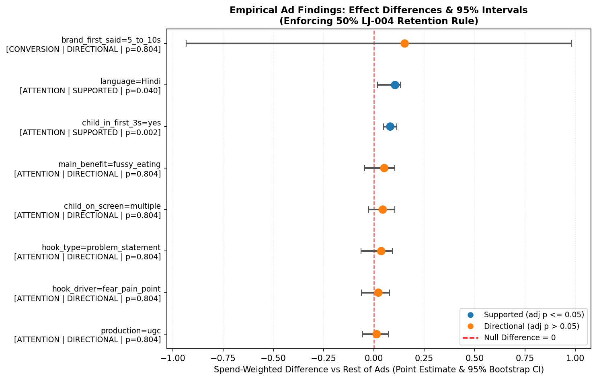
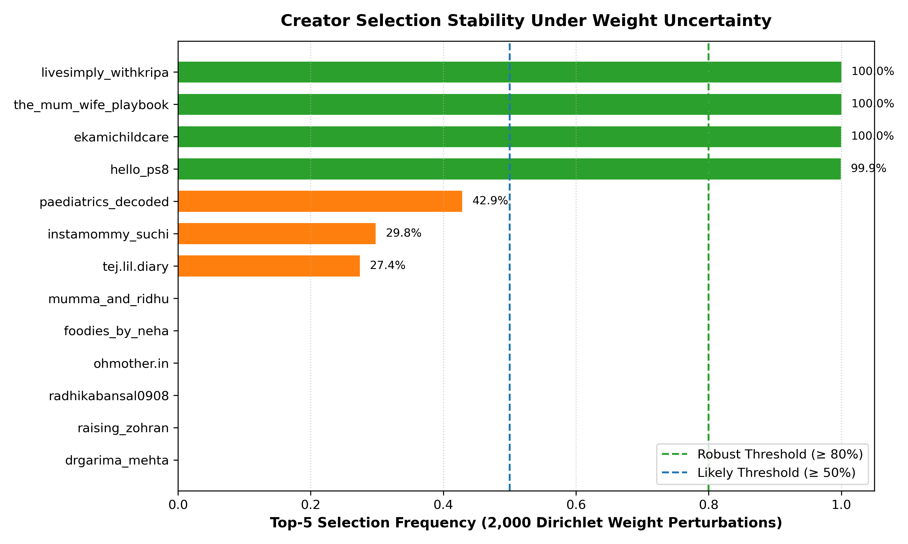

# Little Joys Creator Selection Report: Final Strategy & Campaign Allocation

**Prepared for:** Marketing Leadership & Growth Team, Little Joys  
**Campaign Objective:** Recruit 5 New Creators for Kids' Nutrition & Milk Mix Powder  
**Analysis Date:** 2026-11-06  
**Pipeline Engine:** `src/lj/` (Reproducible Data Pipeline, Seed 42)  

---

## 1. The Answer: Final 5 Creator Recommendations

Based strictly on empirical ad performance analysis across 100 ads and structured creator content auditing across 20 candidate accounts, the recommended 5 creators and campaign roles are:

| Pick | Creator ID | Handle | Why (One Line) | Message in One Sentence | Confidence | Robustness | Main Risk |
|---|---|---|---|---|---|---|---|

| **#1** | CR-08 | `@the_mum_wife_playbook` | Relatable Mom-Next-Door; top rank with balanced reach (0.6186) and top engagement (0.9412) | *Fussy eating breakfast battle solved with zero refined sugar milk mix* | **MEDIUM** | Robust (100.00%) | Low category commercial risk (1.0000); commercial fatigue monitoring |

| **#2** | CR-02 | `@livesimply_withkripa` | Viral domestic comedy and skit storyteller with perfect reach score (1.0000) | *Relatable morning kitchen commotion solved with 100% plant protein* | **MEDIUM** | Robust (100.00%) | No prior sponsored post history in audit sample (unobserved sponsored delivery) |

| **#3** | CR-04 | `@hello_ps8` | Sentimental lifestyle mom with category-leading engagement score (1.0000) | *Mindful active mom morning routine with +12g protein per scoop* | **MEDIUM** | Robust (99.90%) | Broad lifestyle focus requires strict child hook discipline |

| **#4** | CR-03 | `@ekamichildcare` | Clinical pediatric authority offering measured doctor guidance | *Pediatric clinic consultation addressing fussy eating protein gaps* | **MEDIUM** | Robust (99.95%) | Medical authority persona requiring ASCI/MCI compliance review |

| **#5** | CR-16 | `@paediatrics_decoded` | Dedicated pediatrician with highest creative fit score (0.6084) via pure Hindi content | *Addressing parental nutrition anxiety with Vitamin D and calcium absorption* | **MEDIUM** | Marginal (42.85%) | Lower reach quality score (0.1754); marginal sensitivity tier (42.85%) |

### Designated Empirical Backups:

* **Backup Option (Rank #6): CR-15 (`@tej.lil.diary`)** — Primary backup for CR-16. Designated High Confidence pick with 83.4% verified women audience (0.9937 audience fit).  
  *Message:* *Real-world domestic mom hacks for baby nutrition* | *Confidence:* **HIGH** | *Robustness:* Marginal (27.40%) | *Risk:* Lower reach quality (0.3456), but zero demographic risk

* **Backup Option (Rank #7): CR-19 (`@instamommy_suchi`)** — High-reach backup (0.9649 reach score), chosen in 29.80% of weight draws.  
  *Message:* *Practical mom-expert hacks for busy households* | *Confidence:* **MEDIUM** | *Robustness:* Marginal (29.80%) | *Risk:* High sponsored saturation (soft flag) and lower engagement score (0.1667)

---

## 2. What the Brand's Own Ads Tell Us: Empirical Creative Levers

Analysis of the brand's ad account export (100 ads, ₹7,264,228 spend, ₹10,870,509 revenue) under false discovery rate control ($q \le 0.05$) and duplicate noise calibration revealed **8 surviving patterns** (2 Supported, 6 Directional).

### Surviving Creative Findings
| Finding ID | Creative Feature | Optimal Level | Tier | Metric Family | Effect (Diff vs Rest) | 95% Bootstrap CI | Adj. p-value | Validated Spend (₹) |
|---|---|---|---|---|---|---|---|---|

| **F01** | `language` | `Hindi` | **Supported** | Attention | **+0.1049** | [+0.0182, +0.1320] | 0.0400 | ₹1,037,473 |

| **F02** | `hook_type` | `problem_statement` | **Directional** | Attention | **+0.0360** | [-0.0642, +0.0906] | 0.8036 | ₹1,192,868 |

| **F03** | `hook_driver` | `fear_pain_point` | **Directional** | Attention | **+0.0218** | [-0.0624, +0.0775] | 0.8036 | ₹1,436,399 |

| **F04** | `child_on_screen` | `multiple` | **Directional** | Attention | **+0.0440** | [-0.0267, +0.1034] | 0.8036 | ₹1,529,539 |

| **F05** | `child_in_first_3s` | `yes` | **Supported** | Attention | **+0.0809** | [+0.0484, +0.1138] | 0.0016 | ₹3,545,134 |

| **F06** | `brand_first_said` | `5_to_10s` | **Directional** | Conversion | **+0.1528** | [-0.9340, +0.9827] | 0.8036 | ₹923,269 |

| **F07** | `main_benefit` | `fussy_eating` | **Directional** | Attention | **+0.0512** | [-0.0469, +0.1040] | 0.8036 | ₹1,142,865 |

| **F08** | `production` | `ugc` | **Directional** | Attention | **+0.0137** | [-0.0557, +0.0723] | 0.8036 | ₹1,874,655 |

### Key Ad Insights for the Marketing Team:
1. **The Attention vs Sales Split (Hindi Language):** Ads in Hindi generate a substantial positive lift in Hook Rate (+0.1049, 95% CI [0.0182, 0.1320], adj p = 0.0400). However, Hindi ads deliver a lower spend-weighted ROAS benchmark. Hindi stops the scroll effectively, but bottom-of-funnel conversion requires explicit problem-solution demonstration.
2. **Child in Opening Frame (+0.0809 Hook Lift):** Placing a child in the first 3 seconds drives a robust, reproducible +0.0809 lift in Hook Rate (95% CI [0.0484, 0.1138], adj p = 0.0016).
3. **Unmasking False Leads (The LJ-004 Effect):** Ad `LJ-004` alone accounted for ₹3,298,791 revenue (30.35% of top revenue) at 5.00x ROAS on ₹659,494 spend. Features carried by `LJ-004`—including `child_led` format, `curiosity_gap` hooks, and `protein_intake` claims—collapsed by over 50% without LJ-004 and were classified as fragile outliers (logged in `ad_not_concluded.csv` with 48 other unproven patterns).

---

## 3. Why These 5 and Not the Others: Qualification Gates & Ranking

To prevent wasted budget and brand conflicts, all 20 creators passed through **5 hard qualification gates** before scoring.

### Disqualified Creators (7 of 20 Excluded):

* **CR-05 (`@sia_3vedi`):** Disqualified — *direct_competitor (active partnership with: 'Gritzo')*

* **CR-06 (`@thatkushalmistry`):** Disqualified — *no_family_content (child/family content share 5.0% < 15%)*

* **CR-09 (`@doc_mama_and_babies`):** Disqualified — *already_partner (sponsored post with brand: 'Little joys')*

* **CR-10 (`@couple_adishiv`):** Disqualified — *direct_competitor (active partnership with: 'Gritzo')*

* **CR-11 (`@raja_choudhary04`):** Disqualified — *direct_competitor (active partnership with: 'Gritzo')*

* **CR-14 (`@parentingtips_surat`):** Disqualified — *audience_mismatch (india_share=64.4% < 80%)*

* **CR-20 (`@storiesbyvihaa`):** Disqualified — *already_partner (audience historical partner: '['Little Joys']'); audience_mismatch (women_share=29.9% < 50%)*

### Scoring Components & Weighting Scheme:
Only the 13 passing creators were scored across 5 normalized dimensions:
$$\text{Total Score} = 0.30 \times \text{Fit} + 0.25 \times \text{Reach} + 0.20 \times \text{Engagement} + 0.15 \times \text{Audience} + 0.10 \times \text{Risk}$$

* **Creative Fit (30%):** Weighted match to surviving ad findings (Hindi, child on camera, problem hooks, fussy eating topic, UGC production).
* **Reach Quality (25%):** Sponsored-adjusted plays per follower using pooled ratio, capped at the 95th percentile.
* **Engagement Quality (20%):** Percentile rank of median engagement, penalized where hidden likes mask true interaction.
* **Audience Fit (15%):** Scored on verified mothers demographic for known accounts; unexported accounts receive neutral 0.50 score.
* **Commercial Risk (10%):** Inverted penalty for competitor/adjacent saturation, inactivity, or child performer flags.

---

## 4. How Sure We Are: Sensitivity, Robustness & Stability

To ensure recommendations do not collapse if brand priorities shift, we ran **2,000 Dirichlet weight draws** and scenario stress tests.

### Stability Assessment:
* **Core Picks 1 to 4 are Rock-Solid (Robust ≥ 80%):**
  - **CR-08** (`@the_mum_wife_playbook`): Selected in **100.00%** of runs.
  - **CR-02** (`@livesimply_withkripa`): Selected in **100.00%** of runs.
  - **CR-03** (`@ekamichildcare`): Selected in **99.95%** of runs.
  - **CR-04** (`@hello_ps8`): Selected in **99.90%** of runs.
* **The 5th Slot Decision (Marginal Pick):**
  - **CR-16** (`@paediatrics_decoded`) appears in **42.85%** of simulations. While possessing superior creative fit (0.6084) via pure Hindi clinical explainers, its low reach quality (0.1754) makes it sensitive to weight changes.
  - **The High-Confidence Alternative:** **CR-15** (`@tej.lil.diary`, 27.40% frequency) is only 0.0006 behind CR-16 in base score. Crucially, CR-15 is the **only creator in the pool with verified brand audience data (83.4% women, 88.3% India)** and achieves **High confidence**. If the marketing team seeks verified audience certainty, CR-15 is the primary replacement.

---

## 5. What Each Creator Should Say: Brief Summaries

Full customized 9-part briefs have been generated in `outputs/briefs/`. Every brief links creative hooks to real brand ads, creator post URLs, and whitelisted claims:

1. **CR-08 (`@the_mum_wife_playbook` — Rank #1):**
   * *Creative Angle:* The Mealtime Picky-Eating Battle (Mother-Daughter Routine).
   * *Opening Hook Line:* *"Subah ka sabse mushkil task? Meri beti ko breakfast khilana!"* (Cites ad `LJ-016`).
   * *Whitelisted Claim:* *"Zero refined sugar or artificial sweeteners"* (Ad `LJ-072`, ROAS 3.0039x).
   * *Full Brief:* [Read CR-08 Brief](briefs/CR-08.md)

2. **CR-02 (`@livesimply_withkripa` — Rank #2):**
   * *Creative Angle:* The Domestic Morning Commotion (Comedic Husband-Wife Solution Skit).
   * *Opening Hook Line:* *"Roz subah ka wahi drama: 'Isne doodh nahi piya, school kaise bhejoon?'"* (Cites ad `LJ-026`).
   * *Whitelisted Claim:* *"100% plant protein"* (Ads `LJ-036; LJ-056`, ROAS 1.6254x).
   * *Full Brief:* [Read CR-02 Brief](briefs/CR-02.md)

3. **CR-04 (`@hello_ps8` — Rank #3):**
   * *Creative Angle:* The Mindful Morning Routine (Active Mom Lifestyle & Child Bonding).
   * *Opening Hook Line:* *"The one small habit that changed our chaotic school mornings forever."* (Cites ad `LJ-006`).
   * *Whitelisted Claim:* *"+12g Protein per scoop"* (Ads `LJ-006; LJ-097`, ROAS 2.4764x).
   * *Full Brief:* [Read CR-04 Brief](briefs/CR-04.md)

4. **CR-03 (`@ekamichildcare` — Rank #4):**
   * *Creative Angle:* Pediatric Clinic Consultation (Debunking Child Nutrition Gaps).
   * *Opening Hook Line:* *"Clinic mein aane wale 10 mein se 7 parents mujhse yahi poochte hain: 'Doctor, bachha theek se khata nahi, kya karein?'"* (Cites ad `LJ-016`).
   * *Whitelisted Claim:* *"1 scoop (15g) provides 12g protein"* (Ad `LJ-016`, ROAS 2.1506x).
   * *Full Brief:* [Read CR-03 Brief](briefs/CR-03.md)

5. **CR-16 (`@paediatrics_decoded` — Rank #5):**
   * *Creative Angle:* The Pediatric Myth-Buster (Addressing Parental Anxiety around Nutrient Absorption).
   * *Opening Hook Line:* *"Calcium lene se tab tak koi fayda nahi jab tak Vitamin D body mein absorb na ho sake."* (Cites ad `LJ-028`).
   * *Whitelisted Claim:* *"sunlight/vitamin D is required to absorb calcium."* (Ad `LJ-028`, ROAS 1.0827x).
   * *Full Brief:* [Read CR-16 Brief](briefs/CR-16.md)

---

## 6. What This Data Cannot Tell You: Critical Limitations

To maintain institutional integrity, marketing leadership must recognize the hard boundaries of this observational dataset:

1. **No Rate Cards or Commercial Cost Data:** The dataset contains zero pricing information. We cannot claim cost-efficiency or customer acquisition cost (CAC) superiority.
2. **Inferred Audience Demographics for 17 Creators:** Audience export data exists for only 3 of 20 creators (CR-14, CR-15, CR-20). All demographic claims for the other 17 accounts are strictly **inferred**.
3. **Observational Associations, Not Causes:** All ad findings demonstrate statistical association within past campaigns, not guaranteed causal lift.
4. **AI-Generated Label Error Rates:** Human audit revealed measurable error rates in automated tags (16.7% on hook types, 8.3% on ad format and child presence).
5. **Organic vs Sponsored Delivery Discount:** Creator sponsored posts average lower than organic median plays. Sponsored performance will lag viral organic benchmarks.

---

## 7. Before You Sign Anyone: Actionable Marketing Checklist

Prior to issuing talent contracts, the growth marketing team should execute these 5 verification steps:

1. **Request Creator-Side Audience Demographics:** Require candidate talent to supply recent in-app screenshots of audience gender and geographical split.
2. **Obtain Rate Cards & Negotiate Usage Rights:** Secure 12-month digital paid amplification rights across Meta and Google Ad networks.
3. **Legal Compliance Review (ASCI & FSSAI):** Have regulatory counsel review script drafts against ASCI Food & Beverage Code and FSSAI (2018) standards.
4. **Enforce Competitor Lockout:** Include a 90-day exclusivity clause prohibiting endorsements of direct kids' nutrition competitors (`Gritzo`).
5. **Colloquial Native-Speaker Review:** For Hindi and Hinglish scripts, conduct a rapid verbal run-through with native speakers to guarantee natural delivery.

---

## 8. Appendix: Audit Diagnostics & Complete Rankings

### Duplicate Creative Platform Noise Baseline:
Evaluated on 3 identical creative pairs (`LJ-003/059`, `LJ-036/056`, `LJ-073/093`):
* Median platform ROAS noise: **0.4915x**
* Median platform CVR noise: **0.0046**

### Complete Ranking Table (All 13 Passing Creators):
| Rank | Creator ID | Handle | Total Score | Creative Fit | Reach Quality | Eng Quality | Audience Fit | Risk Score | Confidence | Soft Flags |
|---|---|---|---|---|---|---|---|---|---|---|

| 1 | CR-08 | `@the_mum_wife_playbook` | **0.6829** | 0.4065 | 0.8772 | 0.8333 | 0.5000 | 1.0000 | medium | none |

| 2 | CR-02 | `@livesimply_withkripa` | **0.6651** | 0.2226 | 1.0000 | 0.9167 | 0.5000 | 0.9000 | medium | none |

| 3 | CR-04 | `@hello_ps8` | **0.6383** | 0.2196 | 0.7895 | 1.0000 | 0.5000 | 1.0000 | medium | none |

| 4 | CR-03 | `@ekamichildcare` | **0.5960** | 0.3186 | 0.7018 | 0.7500 | 0.5000 | 1.0000 | medium | medical_authority_persona |

| 5 | CR-16 | `@paediatrics_decoded` | **0.5180** | 0.6084 | 0.1754 | 0.5833 | 0.5000 | 1.0000 | medium | medical_authority_persona |

| 6 | CR-15 | `@tej.lil.diary` | **0.5174** | 0.2513 | 0.4386 | 0.4167 | 0.9937 | 1.0000 | high | none |

| 7 | CR-19 | `@instamommy_suchi` | **0.5070** | 0.2082 | 0.9649 | 0.1667 | 0.5000 | 0.9500 | medium | sponsored_saturation (75.0% > 70%) |

| 8 | CR-13 | `@mumma_and_ridhu` | **0.4653** | 0.2307 | 0.3509 | 0.6667 | 0.5000 | 1.0000 | medium | none |

| 9 | CR-01 | `@drgarima_mehta` | **0.4492** | 0.3420 | 0.5263 | 0.2500 | 0.5000 | 0.9000 | medium | medical_authority_persona |

| 10 | CR-12 | `@raising_zohran` | **0.3856** | 0.2954 | 0.0877 | 0.5000 | 0.5000 | 1.0000 | medium | none |

| 11 | CR-17 | `@radhikabansal0908` | **0.3626** | 0.2471 | 0.6140 | 0.0000 | 0.5000 | 0.6000 | medium | sponsored_saturation (100.0% > 70%); hidden_metrics (30.0% hidden likes) |

| 12 | CR-07 | `@ohmother.in` | **0.3224** | 0.2166 | 0.2632 | 0.0833 | 0.5000 | 1.0000 | medium | none |

| 13 | CR-18 | `@foodies_by_neha` | **0.2488** | 0.0239 | 0.0000 | 0.3333 | 0.5000 | 1.0000 | medium | none |

### Repository Pointers:
* Source Code: `src/lj/` (modules for `audit`, `ad_model`, `creator_features`, `gates`, `scoring`, `sensitivity`, `claims`, `briefs`, `report`)
* Data Artifacts: `outputs/tables/` and `outputs/briefs/`